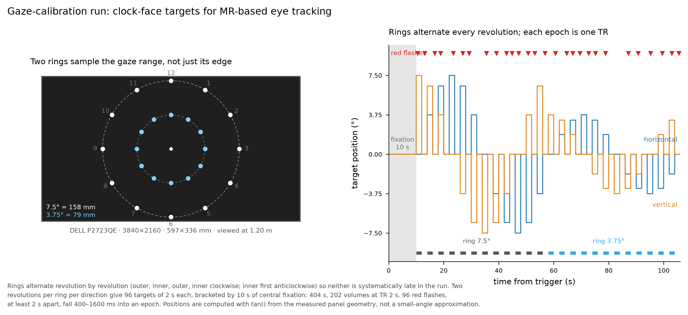

# Clock-face gaze calibration for MR-based eye tracking

A PsychoPy calibration run that gives [DeepMReye](https://github.com/DeepMReye/DeepMReye) the
labelled gaze data it needs to be fine-tuned on an individual participant, together with the
schedule, geometry and scoring code as a separate, testable module.

A white dot steps around a virtual clock face on two rings — 7.5° and 3.75° of visual angle —
holding each position for one TR and returning to the centre for one TR between steps. Rings
alternate revolution by revolution, clockwise then anticlockwise. The participant looks at the dot
wherever it appears and presses a key whenever it briefly turns red; that detection task is what
enforces foveation of each target, which is what makes the run usable as calibration.



Default protocol: 10 s central fixation, 96 targets of 2 s each, 10 s central fixation —
**404 s, 202 volumes at TR 2 s**, with every volume holding a single gaze position.

## Requirements

- **PsychoPy** 2022.2 or later. The Standalone build from [psychopy.org](https://www.psychopy.org)
  is the simplest route on Windows and is what this was developed against (2022.2.2, Python 3.8).
- **numpy**, only to write the label array; the Standalone build already includes it.
- `calib_schedule.py` and `test_calib_schedule.py` import nothing beyond the standard library, so
  the schedule can be inspected and tested on any machine with any Python 3.8+.

## Quick start

```bash
# verify the schedule and geometry — no PsychoPy needed, under a second
python test_calib_schedule.py

# desk check: 96 s, one ring, windowed
python neck_vib_calibration.py --participant TEST --session desk \
    --windowed --distance 600 --rings 7.5 --revolutions 1 --lead-in 0 --lead-out 0

# full protocol, full screen
python neck_vib_calibration.py --participant P01 --session lab

# in the scanner
python neck_vib_calibration.py --participant P01 --session scanner --scanner \
    --tr 2.0 --volumes 202 --series 7
```

On Windows, if PsychoPy is the Standalone build and another Python is first on your PATH (a conda
`(base)` prompt will do it), call it by absolute path:

```powershell
$PP = "C:\Program Files\PsychoPy\python.exe"
& $PP neck_vib_calibration.py --participant P01 --session lab
```

**Run `test_calib_schedule.py` before every session.** It takes under a second and catches a
mis-set eccentricity, viewing distance or screen specification before a participant is in the bore.

## Screen geometry

Target positions are computed with `tan()` from the measured panel geometry, not from PsychoPy's
small-angle `deg` units, so a stated eccentricity is that angle at the eye. Two consequences:

- **Set the physical size and distance for your display.** Defaults are a Dell P2723QE
  (597 × 336 mm active area) viewed at 1.2 m. Use `--screen-mm WIDTHxHEIGHT` and `--distance` for
  anything else — an in-bore projector above all.
- **Resolution is read from the live display, not assumed.** Windows display scaling changes the
  pixel pitch without changing the panel, so the script queries the real resolution before building
  the schedule and rebuilds it again from the window it actually got. It prints a line when it
  makes that correction.

The script refuses to run full screen if any target would fall off the display, naming the limit
rather than drawing off-screen. At 1.2 m on a 336 mm-high panel the maximum vertical eccentricity
is 7.97°, which is why the outer ring is 7.5° and not 10°.

## Output

Four files per run, written to `logs/`:

| file | contents |
|---|---|
| `*_log.tsv` | every event with its measured time: epoch onsets with intended-versus-actual, flashes, key presses |
| `*_events.tsv` | BIDS-style events file for the GLM |
| `*_config.json` | full protocol, screen and window specification, plus the performance summary |
| `*_gazelabels.npy` | `(volumes, 10, 2)` intended gaze in degrees — the array DeepMReye fine-tuning consumes |

The `gaze_labels` block in the config states the convention explicitly: units, origin, axis signs,
what `t = 0` means, what a NaN means, the TR and the lead-volume count. **Check the vertical sign
against DeepMReye's own loader before fine-tuning** — it flips the vertical axis for its screen.

### Aligning labels to the acquisition

- `--tr` must match the calibration series, or every label lands in the wrong volume.
- `--volumes` sets the array length to the series length; it is padded with NaN or truncated.
- `--lead-volumes N` prepends N NaN rows when the scanner *keeps* its dummy volumes, so that label
  row *i* is series volume *i*. Leave it at 0 when dummies are discarded.

### Judging a session

Read the `performance` block before trusting the data:

- `hit_rate` and `false_alarms` — whether the participant was performing the task. Zero hits *and*
  zero false alarms means no key was pressed at all, not that capture failed.
- `effective_refresh_hz`, `frame_interval_ms`, `dropped_frames` — display timing.
- `onset_lag_ms` — measured minus intended epoch onset, excluding the first epoch, which carries
  window warm-up and is reported separately as `first_epoch`.

The presentation loop is driven by the clock, not by counting frames, so a late frame displaces one
stimulus by one frame and nothing accumulates.

## Parameters

| option | default | purpose |
|---|---|---|
| `--participant`, `--session`, `--run` | — | naming for the output files |
| `--scanner` | off | wait for the trigger character and accept the button-box key |
| `--rings` | `7.5,3.75` | ring eccentricities in degrees |
| `--ring-order` | `interleaved` | alternate rings per revolution, or `blocked` for two phases |
| `--revolutions` | 2 | revolutions per ring per direction |
| `--flashes` | 96 | red-flash targets; auto-rescales to ~1 per 4 s when `--revolutions` is set |
| `--lead-in`, `--lead-out` | 10 | central fixation at each end, seconds |
| `--distance` | 1200 | viewing distance in mm |
| `--screen-mm` | Dell P2723QE | physical active area as `WIDTHxHEIGHT` in mm |
| `--screen` | 0 | display index |
| `--tr`, `--volumes`, `--lead-volumes`, `--series` | 2.0, auto, 0, — | acquisition alignment |
| `--windowed` | off | small window for checking flow; **geometry is only correct full screen** |

Escape aborts a run cleanly and still writes every output file, with `aborted: true` recorded.

## Testing

`test_calib_schedule.py` holds nine checks: geometry against the physical panel, clock positions on
both rings, schedule shape and timing, two-ring interleaving (equal visits, equal mean onset,
blocked ordering separating the rings in time), the fixation brackets, flash placement, response
scoring, the gaze-label array, and a random-responder control confirming the detection task can
discriminate attention.

## Licence

See `LICENSE`.
